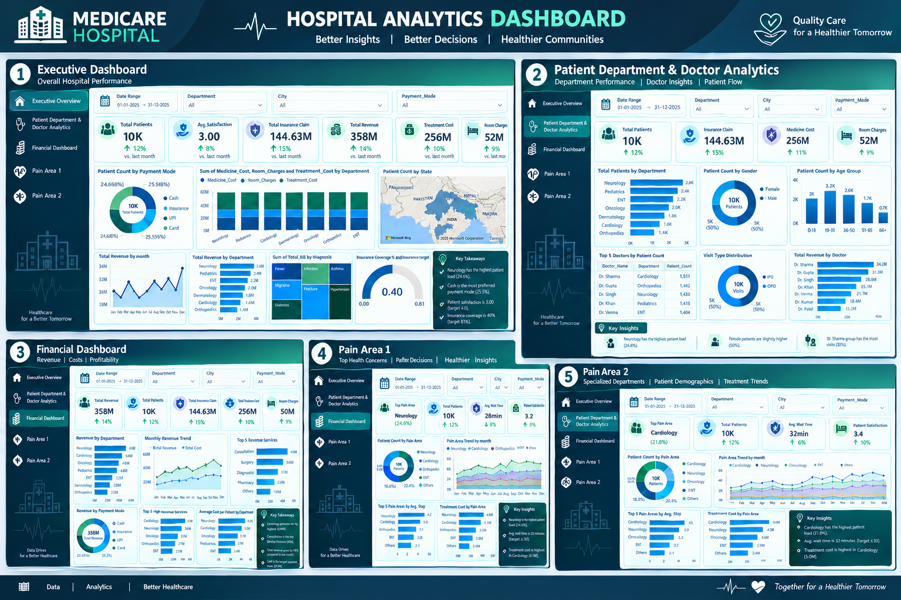

# Hospital Data Analysis & Power BI Dashboard

## Project Overview

This project focuses on analyzing hospital data to uncover meaningful insights related to patients, medical services, hospital operations, and financial performance.

The raw hospital dataset was cleaned and prepared before developing an interactive Power BI dashboard for data analysis and visualization.

## Project Highlights

- Built an interactive Power BI dashboard to analyze hospital data and performance
- Cleaned and transformed raw healthcare data for reliable analysis
- Developed KPI-driven visualizations for key hospital metrics
- Analyzed patients, doctors, departments, visits, and payment patterns
- Created interactive charts and filters for data exploration
- Identified trends and insights to support data-driven decision-making

 ## Tools & Technologies

- Microsoft Excel
- Power Query
- Power BI
- DAX
- Data Cleaning & Transformation
- Data Visualization

 ## Dataset & Data Preparation

The project uses raw hospital data containing information related to patients, doctors, departments, visits, and payments.

Before creating the dashboard, the raw data was cleaned and transformed to improve data quality and make it suitable for analysis.

### Data Preparation Process

- Removed duplicate and unnecessary records
- Handled missing and inconsistent values
- Standardized data formats and fields
- Cleaned and transformed the dataset using Excel and Power Query
- Prepared the cleaned data for Power BI analysis

## Dashboard Overview

The Power BI dashboard provides an interactive view of hospital performance and helps analyze key operational and financial metrics.

### Key Areas Covered

- Patient Analysis
- Doctor & Department Analysis
- Visit & Admission Analysis
- Payment & Revenue Analysis
- Key Performance Indicators (KPIs)
- Interactive filters and visualizations

## Dashboard Preview

## Dashboard Modules

### 01. Executive Summary

